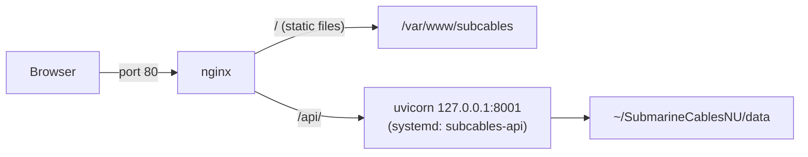

# Deploying to the Northwestern (NUIT) VM

These are the steps used to put CableIncidentsDB on the NUIT-provided VM. They're written so someone new can rebuild the setup from scratch or take over the existing one.

## Current setup

| | |
|---|---|
| Host | `evsubcables.ads.northwestern.edu` (`129.105.88.39`) |
| OS | Red Hat Enterprise Linux 8.10 |
| Web server | nginx on port 80. It serves the built frontend from `/var/www/subcables` and forwards `/api/` to the backend. |
| Backend | FastAPI/uvicorn on `127.0.0.1:8001`, run by the systemd service `subcables-api` |
| Code | `/home/<netid>/SubmarineCablesNU`, cloned from the GitLab group repo |
| Python | 3.11, in a virtualenv at `backend/.venv` |
| Who can reach it | Only people on the Northwestern VPN who have an account on the VM and use an SSH tunnel. See [Viewing the site](#viewing-the-site). |

Throughout this doc, replace `<netid>` with your NetID. You need an account on the VM in the `wheel` group, which gives you `sudo`. `sudo` asks for your NetID password.



## 1. Connect to the VM

1. Connect to the **Northwestern VPN**. If you aren't on the VPN, SSH just times out.
2. From a terminal on your laptop (PowerShell is fine on Windows), run:

   ```bash
   ssh <netid>@evsubcables.ads.northwestern.edu
   ```

   Use `@` between the NetID and host, not `/`. The first time, type `yes` to accept the host fingerprint.

## 2. Install system packages

```bash
sudo dnf install -y git nginx
sudo dnf install -y python3.11 python3.11-pip python3.11-devel
python3.11 --version
```

RHEL 8's default `python3` is 3.6, and the `python39` module gives 3.9. Neither works: current FastAPI needs a newer Python, and `fastembed>=0.8.0` needs 3.10 or newer. Make sure you create the virtualenv with `python3.11` specifically.

Node/npm aren't installed on the VM and aren't needed there. The frontend is built on a laptop and uploaded (step 5).

## 3. Get the code

```bash
cd ~
git clone https://gitlab.com/nusubmarinecables-group/SubmarineCablesNU.git
cd SubmarineCablesNU
```

If the repo is private, git asks for a username and password. Use your GitLab username and a GitLab **personal access token** as the password, not your normal password. You can also add an SSH key to GitLab and clone with `git@gitlab.com:nusubmarinecables-group/SubmarineCablesNU.git`.

## 4. Set up the backend

```bash
cd ~/SubmarineCablesNU/backend
python3.11 -m venv .venv
source .venv/bin/activate
pip install --upgrade pip
pip install -r requirements.txt
```

To check that it works, start it by hand:

```bash
export CABLEINCIDENTS_DATA_DIR=$HOME/SubmarineCablesNU/data
uvicorn app.main:app --host 127.0.0.1 --port 8001
```

From a second SSH session, run `curl http://127.0.0.1:8001/api/v1/health`. It should return JSON with incident and cable counts. Stop the manual run with Ctrl+C. Step 7 makes the backend run permanently.

## 5. Build and upload the frontend

Run these **on your laptop, not on the VM**, from the repo folder:

```powershell
cd frontend
npm install
npm run build
scp -r dist <netid>@evsubcables.ads.northwestern.edu:~/SubmarineCablesNU/frontend/dist
```

You don't need to set `VITE_API_BASE_URL`. The default, `/api/v1`, is correct because nginx serves the frontend and the API from the same address.

Then, **on the VM**, copy the files to where nginx serves them and set their permissions:

```bash
sudo mkdir -p /var/www/subcables
sudo rsync -a --delete ~/SubmarineCablesNU/frontend/dist/ /var/www/subcables/
sudo chown -R nginx:nginx /var/www/subcables
sudo chcon -R -t httpd_sys_content_t /var/www/subcables
sudo setsebool -P httpd_can_network_connect 1
```

The last two commands are for SELinux, which is on by default in RHEL:

- `chcon` lets nginx read the files.
- `httpd_can_network_connect` lets nginx forward requests to the backend.

Without them, you get 403 or 502 errors even when everything else is right.

## 6. Configure nginx

**IPv6 fix.** This VM has no IPv6, and nginx's default config tries to listen on IPv6. Startup then fails with:

```text
socket() [::]:80 failed (97: Address family not supported by protocol)
```

Open `/etc/nginx/nginx.conf` (for example `sudo vi /etc/nginx/nginx.conf`) and comment out the IPv6 listen line in the default `server` block:

```nginx
    listen       80 default_server;
#   listen       [::]:80 default_server;
```

**Site config.** In that same default `server` block, replace the `root` line and the `location` blocks with the following. You could also put it in its own `server` block in `/etc/nginx/conf.d/subcables.conf` and remove the default one.

```nginx
root /var/www/subcables;
index index.html;

location /api/ {
    proxy_pass http://127.0.0.1:8001/api/;
    proxy_http_version 1.1;
    proxy_set_header Host $host;
    proxy_set_header X-Real-IP $remote_addr;
    proxy_set_header X-Forwarded-For $proxy_add_x_forwarded_for;
    proxy_set_header X-Forwarded-Proto $scheme;
}

location / {
    try_files $uri $uri/ /index.html;
}
```

Test the config, then start or reload nginx:

```bash
sudo nginx -t
sudo systemctl enable --now nginx
sudo systemctl reload nginx
curl -I http://127.0.0.1
```

## 7. Run the backend as a service

A systemd service keeps the backend running after you log out, restarts it if it crashes, and starts it when the VM boots.

Create `/etc/systemd/system/subcables-api.service`, for example with `sudo vi /etc/systemd/system/subcables-api.service`:

```ini
[Unit]
Description=Submarine Cables API
After=network.target

[Service]
User=<netid>
WorkingDirectory=/home/<netid>/SubmarineCablesNU/backend
Environment=CABLEINCIDENTS_DATA_DIR=/home/<netid>/SubmarineCablesNU/data
ExecStart=/home/<netid>/SubmarineCablesNU/backend/.venv/bin/uvicorn app.main:app --host 127.0.0.1 --port 8001
Restart=always
RestartSec=3

[Install]
WantedBy=multi-user.target
```

To enable "Find more sources", add `Environment=GOOGLE_API_KEY=...` under `[Service]`. Only people with `sudo` can read this file. Don't commit the key anywhere.

Start the service:

```bash
sudo systemctl daemon-reload
sudo systemctl enable --now subcables-api
```

Useful commands:

```bash
sudo systemctl status subcables-api        # is it running?
sudo systemctl restart subcables-api       # after code or data changes
sudo journalctl -u subcables-api -f        # live logs (Ctrl+C to exit)
sudo journalctl -u subcables-api -n 100    # last 100 log lines
```

If you started uvicorn by hand in step 4, stop that process first. Otherwise port 8001 is already in use and the service fails to start.

## Viewing the site

Until NUIT opens the VM to the network, port 80 isn't reachable from outside the VM. To view the site:

1. Connect to the Northwestern VPN.
2. On your laptop, open an SSH tunnel and leave the window open:

   ```bash
   ssh -L 8080:127.0.0.1:80 <netid>@evsubcables.ads.northwestern.edu
   ```

3. Open http://localhost:8080 in your browser.

The tunnel forwards port 8080 on your laptop to port 80 on the VM. Anyone who wants to view the site this way needs the VPN *and* their own account on `evsubcables`.

## Updating the site

**Backend code or data changes** (on the VM):

```bash
cd ~/SubmarineCablesNU
git pull
source backend/.venv/bin/activate && pip install -r backend/requirements.txt   # only if requirements.txt changed
sudo systemctl restart subcables-api
```

**Frontend changes:**

1. On your laptop, run `npm run build`, then upload the files with the same `scp` command as in step 5.
2. On the VM, rerun the `rsync`, `chown`, and `chcon` commands from step 5.

No nginx restart is needed.

Check which branch the VM is on with `git branch`. The GitLab repo only receives `development` (automatically) and `main` (merged by hand). See [Branches and contributing](README.md#branches-and-contributing).

## Still needed from NUIT

A request is pending, sent through the PI, for:

- **A public hostname** for the site. It could be a friendlier name than `evsubcables.ads.northwestern.edu`.
- **An HTTPS certificate** for that hostname, or permission to set one up.
- **Inbound firewall access on ports 80 and 443** so people can reach the site without the VPN and SSH tunnel.

nginx serves the site on port 80 on the VM. The `8080` in the tunnel command only exists on your laptop. Once HTTPS is set up, nginx needs a `listen 443 ssl` block with the certificate paths, plus a redirect from port 80 to 443.

## Handing off the VM

Right now the service runs as one student's NetID, and the code lives in that student's home directory. For the lab to own the VM:

1. Ask NUIT to create accounts on `evsubcables` for the lab maintainers, in the `wheel` group so they have `sudo`. You could also ask for a shared service account.
2. Have the new owner repeat steps 3, 4, and 7 under their own account. That means cloning the repo, creating the venv, and pointing the systemd unit's `User`, `WorkingDirectory`, `Environment`, and `ExecStart` at their home directory.
3. Run `sudo systemctl daemon-reload && sudo systemctl restart subcables-api`. Then confirm the site still works through the tunnel.
4. Once the student's account is removed, the old checkout goes with it. Nothing else depends on it, because nginx serves from `/var/www/subcables`.

## Troubleshooting

| Symptom | Cause / fix |
|---------|-------------|
| `ssh` hangs, then times out | You're not on the Northwestern VPN. Also check the syntax is `<netid>@host`. |
| `sudo` refuses your password, or says you're not in sudoers | Your account isn't in `wheel`. Ask NUIT. |
| nginx won't start: `[::]:80 failed (97: Address family not supported)` | Comment out the `listen [::]:80` line (step 6). |
| `pip` can't find `fastapi>=0.115` or `fastembed>=0.8.0` | The venv was created with Python 3.6 or 3.9. Delete `backend/.venv` and recreate it with `python3.11 -m venv .venv`. |
| `npm: command not found` on the VM | Expected. Build the frontend on your laptop (step 5). |
| `scp` fails or is run from the wrong place | Run `scp` from your laptop, not from inside the SSH session. |
| Browser shows a 403 or the nginx default page | The files aren't in `/var/www/subcables`, or they lack the SELinux label. Rerun the `rsync`, `chown`, and `chcon` commands from step 5. Also check that `root` in the nginx config points to `/var/www/subcables`. |
| Site loads, but the map says "Could not load map data", or `/api/` returns 502 | The backend is down, or SELinux is blocking the proxy. Check `sudo systemctl status subcables-api` and `curl http://127.0.0.1:8001/api/v1/health`, and make sure `httpd_can_network_connect` is on (`getsebool httpd_can_network_connect`). |
| The service keeps restarting | Check `sudo journalctl -u subcables-api -n 100`. Common causes: wrong paths in the unit file, a missing venv, or port 8001 already taken by a uvicorn you started by hand. |
| `localhost:8080` doesn't load | The SSH tunnel window was closed, or you used port 80 instead of 8080 in the browser. Reopen the tunnel. |
