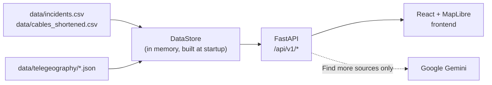

# CableIncidentsDB

An interactive map and searchable database of submarine cable incidents (cuts, damage, sabotage, and suspected state activity) shown on top of the global undersea cable network. Each incident is plotted on the map and color-coded by how strongly a nation state is suspected and whether the incident has been resolved. You can filter by region, actor, status, and cable type, search in plain English, and open any cable to see its full incident history. It was built for the Northwestern submarine cables research project.


## Contents

- [Project status and handoff](#project-status-and-handoff)
- [Tech stack](#tech-stack)
- [Prerequisites](#prerequisites)
- [Quick start (Docker)](#quick-start-docker)
- [Local development (without Docker)](#local-development-without-docker)
- [Project structure](#project-structure)
- [How it works](#how-it-works)
- [Data](#data)
- [Editing the data](#editing-the-data)
- [Environment variables](#environment-variables)
- [API endpoints](#api-endpoints)
- [Map behavior and legend](#map-behavior-and-legend)
- [Deployment](#deployment)
- [Troubleshooting](#troubleshooting)
- [Known limitations](#known-limitations)
- [Branches and contributing](#branches-and-contributing)
- [Team and credits](#team-and-credits)
- [License note](#license-note)

## Project status and handoff

The original student team is handing this project off to the research lab. This section covers what exists, where it runs, and what the lab needs to take ownership of.

### What's done

- Full-screen map of 243 incidents and 698 cables, drawn over Telegeography cable routes.
- Markers colored by state involvement and resolution status. Incidents at the same location are grouped into one numbered marker.
- Filters for region, nation-state involvement, investigation status, suspected country, and cable type. Filter counts update live.
- Natural-language search with a keyword fallback. It runs locally, with no API key or database.
- Detail panels for incidents and cables, with color-coded incident cards on each cable.
- Optional "Find more sources" button that uses Google Gemini to suggest extra sources for an incident. These are labeled as AI-found and unverified.
- Light and dark mode.

### Where it runs

| Environment | Status | How to reach it |
|-------------|--------|-----------------|
| Local machine | Working | `docker compose up --build`, then open http://localhost:5174 |
| NUIT VM (`evsubcables.ads.northwestern.edu`) | Running, but private | Northwestern VPN plus an SSH tunnel. Only people with an account on the VM can reach it. See [NUIT_VM_DEPLOY.md](NUIT_VM_DEPLOY.md). |
| Render / Vercel / Cloud Run | TODO: confirm whether these are still live | See [DEPLOYMENT.md](DEPLOYMENT.md) and [CLOUD_RUN_DEPLOY.md](CLOUD_RUN_DEPLOY.md) |

### Access to transfer

None of these credentials are stored in the repo. Each one needs to be handed over or recreated by the lab:

- [ ] **Code repositories.** The primary repo is on a personal GitHub account (`github.com/ashkaranha/SubmarineCablesNU`). A GitHub Action mirrors the `development` branch to the group repo at `gitlab.com/nusubmarinecables-group/SubmarineCablesNU`, using a `GITLAB_MIRROR_TOKEN` secret. The lab should pick one repo as the canonical home. The GitLab group is probably the right choice. Then add lab members as maintainers.
- [ ] **NUIT VM accounts.** The VM is currently set up under one student's NetID. That includes the systemd service user and the `/home/<netid>/SubmarineCablesNU` checkout. Lab members need their own accounts on `evsubcables` from NUIT, and the service should be moved to a lab-owned account. See [NUIT_VM_DEPLOY.md](NUIT_VM_DEPLOY.md#handing-off-the-vm).
- [ ] **Google Gemini API key** (`GOOGLE_API_KEY`). This key is tied to someone's Google account. The lab should create its own key in [Google AI Studio](https://aistudio.google.com/apikey).
- [ ] **Hosting accounts** (Render, Vercel/Netlify, Google Cloud), if any of them are still in use.

### Open items

- **Public URL.** A request went to NUIT, through the PI, for a public hostname, HTTPS, and inbound firewall access on ports 80 and 443 for the VM. It is still pending. Until NUIT finishes it, the site is reachable only over VPN plus an SSH tunnel.
- **Data quality.** Some incidents have no coordinates in the CSV, so the app places them approximately (see [How it works](#how-it-works)). The CSV's own `region` column is unreliable, and about 76 incidents still fall into the "Unknown" region. `python -m scripts.data_quality_report` (run from `backend/`) lists what's missing.
- **Legacy database service.** `docker-compose.yml` still starts a Postgres/pgvector `db` container from an earlier version of search. The app no longer uses it. It could be removed, along with `backend/scripts/ingest_vectordb.py`, `ensure_vectordb.py`, `backend/app/services/vector_db.py`, and `backend/db/schema.sql`.

### Suggested next steps

- Date-range filter (slider or from/to dates) on the incident list and map.
- Export the current filtered incident list to CSV.
- Shareable links that save the current filters and selection in the URL.
- A visible "approximate location" badge on incidents whose position came from the cable route rather than real coordinates.
- Hover tooltips on incident markers.

### Contacts

<!-- TODO: fill these in -->

| Role | Name | Contact |
|------|------|---------|
| Principal investigator | TODO | TODO |
| Original student team | TODO | TODO |
| Lab maintainer going forward | TODO | TODO |
| NUIT contact for the VM | TODO | TODO |

## Tech stack

- **Frontend:** React, TypeScript, Vite, Tailwind CSS, MapLibre GL JS, Zustand
- **Backend:** FastAPI (Python), all data held in memory
- **Data:** CSV files plus a pinned snapshot of Telegeography's cable GeoJSON
- **Search:** BM25 keyword retrieval (`backend/app/services/search_lexical.py`), then a local cross-encoder reranker ([fastembed](https://github.com/qdrant/fastembed), ONNX Runtime, model `Xenova/ms-marco-MiniLM-L-6-v2`). No PyTorch, no API key, and no database.
- **AI-found sources (optional):** Google Gemini, used only by the "Find more sources" button

## Prerequisites

- **Docker Desktop** if you want the one-command setup. On Windows, Docker Desktop has to be open and running before you use `docker compose`.
- Without Docker:
  - **Python 3.10 or newer.** `fastembed>=0.8.0` won't install on older versions; 3.11 is what the Docker image and VM use.
  - **Node.js 20** (matches `frontend/Dockerfile`) and npm.

## Quick start (Docker)

```bash
docker compose up --build
```

- Web: http://localhost:5174
- API: http://localhost:8001 (interactive docs at http://localhost:8001/docs)

The map, filters, and search all work with only this command. You don't need an API key or a database. The first search after a fresh start takes a few extra seconds while the reranker model downloads. It's cached after that.

**Optional AI-found sources.** Get a free key from [Google AI Studio](https://aistudio.google.com/apikey) and put it in a `.env` file next to `docker-compose.yml`. That file is gitignored.

```bash
echo 'GOOGLE_API_KEY=your-key-here' > .env
```

Without a key, the "Find more sources" button shows an "unavailable" message. Nothing else is affected.

## Local development (without Docker)

**Backend** (terminal 1):

```bash
cd backend
python -m venv .venv
# Windows: .venv\Scripts\activate    macOS/Linux: source .venv/bin/activate
python -m pip install -r requirements.txt
python -m uvicorn app.main:app --reload --host 127.0.0.1 --port 8001
```

**Frontend** (terminal 2):

```bash
cd frontend
npm install
npm run dev
```

Open http://localhost:5174. The Vite dev server forwards `/api` requests to the backend at `http://127.0.0.1:8001`. To point it somewhere else, set `VITE_API_PROXY_TARGET`.

To check that the backend you're talking to is the current one, open http://127.0.0.1:8001/api/v1/health. It returns incident, cable, and marker counts.

## Project structure

```text
SubmarineCablesNU/
├── backend/
│   ├── app/
│   │   ├── main.py              # FastAPI app; loads data at startup
│   │   ├── config.py            # Settings (CABLEINCIDENTS_* env vars)
│   │   ├── api/v1/routes.py     # All /api/v1 endpoints
│   │   ├── models/schemas.py    # Pydantic response models
│   │   └── services/
│   │       ├── data_loader.py   # Reads CSVs + Telegeography into the in-memory DataStore
│   │       ├── actor_tier.py    # Confirmed / suspected / no state actor
│   │       ├── region.py        # Assigns regions from lat/lng boxes
│   │       ├── search_*.py      # BM25 search, query intent, filter counts
│   │       ├── reranker.py      # fastembed cross-encoder
│   │       ├── source_finder.py # Gemini "Find more sources"
│   │       └── vector_db.py, embeddings.py  # Legacy, unused by the app
│   ├── scripts/                 # Data-maintenance scripts (see "Editing the data")
│   ├── db/schema.sql            # Legacy pgvector schema
│   ├── Dockerfile
│   └── requirements.txt
├── frontend/
│   ├── src/
│   │   ├── api/                 # API client
│   │   ├── map/                 # CableMap, markers, legend
│   │   ├── panel/               # Bottom panel: incident and cable views
│   │   ├── rail/                # Left sidebar: list, search, filters
│   │   ├── store/uiStore.ts     # UI state (Zustand)
│   │   └── types/api.ts         # Types matching the backend schemas
│   ├── vite.config.ts           # Dev server on 5174, /api proxy
│   └── Dockerfile
├── data/                        # CSVs + Telegeography snapshot (see "Data")
├── docker-compose.yml
├── DEPLOYMENT.md                # Render + Vercel/Netlify
├── CLOUD_RUN_DEPLOY.md          # Google Cloud Run
├── NUIT_VM_DEPLOY.md            # Northwestern VM (RHEL 8, nginx, systemd)
└── combined.xlsx                # Archive only; the app doesn't use it
```

## How it works



When the backend starts, it reads the CSVs and Telegeography files once and builds an in-memory `DataStore`. Every request is served from memory. The app has no database, so changes to the CSVs take effect when you restart the API.

While loading, the backend derives these fields:

- **Actor tier** (`actor_tier.py`) comes from the `Nation State Suspected` column. Each incident becomes *confirmed*, *suspected*, or *none*. This tier sets the marker's fill color.
- **Location.** Each incident's position comes from the first source available, in this order:
  1. Latitude/Longitude in `incidents.csv`.
  2. The midpoint of the cable's landing points.
  3. The midpoint of the cable's route in the Telegeography GeoJSON.

  The source used is returned as `coordinate_source`: `csv`, `landing_midpoint`, `cable_route`, or `none`. Telegeography's landing-point data is currently empty, so the fallback is in practice the cable route.
- **Region** (`region.py`) comes from the incident's coordinates, using bounding boxes: Baltic Sea, North Sea / Norwegian Sea, Mediterranean, Red Sea / Arabian Sea, Taiwan Strait / SCS, Caribbean, Arctic, North Atlantic, and Pacific. Anything outside those boxes is "Other", and anything with no coordinates is "Unknown". The CSV's own `region` column isn't used because it's inconsistent.
- **Search.** BM25 keyword retrieval narrows the corpus of roughly 1,600 documents (incidents plus cables). Then the cross-encoder reranker scores the top candidates for relevance. If the reranker isn't available yet, the search box falls back to keyword matches.

## Data

| File | Purpose |
|------|---------|
| `data/incidents.csv` | 243 incident records. This is the main dataset. |
| `data/cables_shortened.csv` | 698 rows of cable metadata (name, type, status, and so on) |
| `data/telegeography/` | Pinned Telegeography API v3 snapshot: cable routes, landing points, cable list. The fetch date is in `VERSION.txt`. |
| `data/incidents_coords_review.csv` | Working file. Proposed coordinates for incidents that are missing them. Produced by `scripts/backfill_coordinates.py` and applied by `scripts/apply_coordinate_backfill.py`. The app doesn't read it. |
| `data/cables_status_review.csv` | Working file. Proposed statuses for cables that are missing one. Produced by `scripts/backfill_cable_status.py` and applied by `scripts/apply_cable_status_review.py`. The app doesn't read it. |

`combined.xlsx` in the repo root is an archive only. The app doesn't use it.

## Editing the data

1. Edit `data/incidents.csv` or `data/cables_shortened.csv` in Excel, Google Sheets, or a text editor. Keep the column headers unchanged, and save as UTF-8 CSV.
2. To link an incident to a cable, its `Canonical_Cable_Name` must exactly match that cable's `Cable Name` in `cables_shortened.csv`.
3. Restart the API. With Docker, run `docker compose restart api`. Locally, `--reload` only watches code, so stop and restart uvicorn. On the VM, run `sudo systemctl restart subcables-api`. You don't need a separate reindex step.

**Helper scripts.** Run these from `backend/` with `python -m scripts.<name>`:

| Script | What it does |
|--------|--------------|
| `data_quality_report` | Read-only. Lists missing or blank values in both CSVs. |
| `backfill_coordinates` | Proposes coordinates for incidents that are missing them. It parses coordinates from the location text, or geocodes the text with OpenStreetMap Nominatim. Writes `incidents_coords_review.csv`. |
| `apply_coordinate_backfill` | Writes the reviewed coordinates into `incidents.csv`. Supports `--dry-run`. It never overwrites existing coordinates. |
| `backfill_cable_status` | Proposes statuses for cables that are missing one, using Telegeography's public data. Writes `cables_status_review.csv`. |
| `apply_cable_status_review` | Writes the confident ("derived") statuses into `cables_shortened.csv`. |

The workflow is: propose, review the CSV by hand and delete any rows you don't trust, then apply.

**Refreshing Telegeography data.** Download these three files into `data/telegeography/`, keeping the existing filenames, and put the fetch date in `VERSION.txt`:

- `https://www.submarinecablemap.com/api/v3/cable/cable-geo.json` saved as `cable-geo.json`
- `https://www.submarinecablemap.com/api/v3/landing-point/landing-point-geo.json` saved as `landing-point-geo.json`
- `https://www.submarinecablemap.com/api/v3/cable/all.json` saved as `cable-all.json`

## Environment variables

The backend reads these from real environment variables. It doesn't load a `.env` file on its own. Docker Compose passes `GOOGLE_API_KEY` through from the root `.env`. When running locally, set them in your shell first, for example `$env:GOOGLE_API_KEY="..."` in PowerShell or `export GOOGLE_API_KEY=...` in bash. `backend/.env.example` lists the common ones.

| Variable | Default | Purpose |
|----------|---------|---------|
| `GOOGLE_API_KEY` | none | Enables "Find more sources". Optional. |
| `CABLEINCIDENTS_GOOGLE_MODEL_NAME` | `gemini-3.6-flash` | Gemini model for "Find more sources". Update it if Google deprecates the model. |
| `CABLEINCIDENTS_CORS_ORIGINS` | localhost on ports 5173 and 5174 | Frontend URLs allowed to call the API. Accepts a JSON array or a comma-separated list. You only need it when the frontend runs on a different domain from the API. |
| `CABLEINCIDENTS_DATA_DIR` | `<repo>/data` | Folder containing the CSVs and `telegeography/` |
| `CABLEINCIDENTS_RERANKER_MODEL_NAME` | `Xenova/ms-marco-MiniLM-L-6-v2` | Search reranker model |
| `FASTEMBED_CACHE_PATH` | fastembed default | Where the reranker model is cached |
| `CABLEINCIDENTS_DATABASE_URL` | local Postgres | Legacy. Only the unused vector-DB scripts read it. |

Frontend variables:

| Variable | When | Purpose |
|----------|------|---------|
| `VITE_API_PROXY_TARGET` | `npm run dev` | Where the dev server forwards `/api` (default `http://127.0.0.1:8001`) |
| `VITE_API_BASE_URL` | `npm run build` | API base URL compiled into the production build (default `/api/v1`, which suits a same-domain setup like the NUIT VM) |

The CORS line in `backend/.env.example` lists only port 5173, but the dev server runs on 5174. That doesn't matter in local development because Vite proxies `/api` and no cross-origin request happens. If you copy that line into a real config, include 5174 as well.

## API endpoints

All endpoints are `GET` under `/api/v1`. Interactive docs are at `/docs` on the backend.

| Path | Description |
|------|-------------|
| `/health` | Service health plus incident, cable, and marker counts |
| `/meta/filters` | Available filter values |
| `/cables` | Cable list with incident counts |
| `/cables/{name}` | One cable's details and its incidents |
| `/cables/{name}/incidents` | Incidents for one cable |
| `/incidents` | All incidents. Optional filters: `q`, `region`, `actor_tier`, `investigation_status`, `suspected_country`, `cable_type`. |
| `/incidents/{id}` | One incident |
| `/incidents/{id}/sources` | Dataset sources plus AI-found sources for one incident. AI-found sources need `GOOGLE_API_KEY`. |
| `/markers` | One map marker per incident, with fill, ring, and `coordinate_source`. Takes the same filters as `/incidents`. The frontend groups markers that share a location. |
| `/map/cables` | Cable route GeoJSON |
| `/map/landing-points` | Landing point GeoJSON |
| `/search` | Search over incidents and cables, using BM25 plus the reranker |

## Map behavior and legend

**Marker legend:**

| Part of the marker | Meaning |
|--------------------|---------|
| Red fill | Confirmed state actor |
| Amber fill | Suspected state actor |
| Slate (gray) fill | No state actor |
| Green ring | Resolved |
| Dark ring | Unresolved / ongoing |
| Number on the marker | Several incidents at the same location. Click it to see the list. |

**How the map behaves:**

- The left rail switches between Incidents and Cables, with one search box and dropdown filters. Incidents can be sorted newest-first or oldest-first.
- Click an incident marker, or a row in the list, to open its details in the bottom panel. A "Related cable" strip links to the cable.
- Hover over a cable to see its name and incidents. Click a cable to see its details and color-coded incident cards. The "!" markers along a selected cable open that specific incident.
- Click the map background, press Escape, or click Close to dismiss the panel.
- The light/dark mode choice is saved in `localStorage`.

## Deployment

| Target | Guide | Notes |
|--------|-------|-------|
| Northwestern NUIT VM | [NUIT_VM_DEPLOY.md](NUIT_VM_DEPLOY.md) | RHEL 8, nginx, systemd. Currently deployed, VPN only. |
| Render + Vercel/Netlify | [DEPLOYMENT.md](DEPLOYMENT.md) | Free tiers. Render's free instance sleeps when idle. |
| Google Cloud Run | [CLOUD_RUN_DEPLOY.md](CLOUD_RUN_DEPLOY.md) | Fallback if Render runs out of memory |

On every target the shape is the same: the frontend is a static site built with `npm run build`, and the backend is one FastAPI process on port 8001. If both are served from the same domain behind a reverse proxy, as on the VM, you don't need any CORS or API URL settings. If they're on different domains, set `VITE_API_BASE_URL` on the frontend and `CABLEINCIDENTS_CORS_ORIGINS` on the backend.

## Troubleshooting

**Docker**

- **`open //./pipe/dockerDesktopLinuxEngine: The system cannot find the file specified`.** Docker Desktop isn't running. Start it, wait until it says "Engine running", then try again.
- **`failed to solve: Unavailable ... EOF` during the build.** Docker dropped the connection while sending files. Restart Docker Desktop and run the build again. `frontend/.dockerignore` keeps `node_modules` and `dist` out of the build. If you add other large files, list them there too.
- **Compose behaves strangely after dependencies change.** Run `docker compose up --build` to rebuild. You need a rebuild after any change to `requirements.txt` or `package.json`.

**Running locally**

- **The map says "Could not load map data".** The frontend can't reach the API. Make sure the backend is running on port 8001, or check `docker compose logs api`.
- **Data looks old, or the counts are wrong.** An old backend process may still be running. Open http://127.0.0.1:8001/api/v1/health and check the counts. If they're stale, stop every uvicorn/Python process. On Windows, use Task Manager or `Get-Process python | Stop-Process`. Then restart the backend.
- **`[WinError 10013]` or "address already in use" when starting uvicorn.** Something is already using port 8001, usually a backend you started earlier. Stop it first, as described above.
- **`pip` can't find `fastapi>=0.115` or `fastembed>=0.8.0`.** Your Python is too old. Use Python 3.10+; 3.11 is recommended.
- **The search box shows "keyword matches only".** The reranker model is still downloading on its first use, or the machine can't reach the internet to download it. Everything else keeps working.
- **"Find more sources" shows an error.** This is expected without `GOOGLE_API_KEY`. If a key is set, the Gemini model may have been deprecated or the daily quota used up. See [DEPLOYMENT.md](DEPLOYMENT.md#known-gotchas).

**NUIT VM**

- **SSH to `evsubcables.ads.northwestern.edu` times out.** Connect to the Northwestern VPN first. The command is `ssh <netid>@evsubcables.ads.northwestern.edu`, with an `@` (not a `/`).
- For more VM problems (nginx won't start, 502 errors, SELinux), see [NUIT_VM_DEPLOY.md](NUIT_VM_DEPLOY.md#troubleshooting).

## Known limitations

- The data is a curated CSV, not a live feed. New incidents have to be added by hand.
- Some incident locations are approximate. They're placed at the cable route midpoint, not where the incident happened.
- About 76 incidents end up in the "Unknown" region because they have no usable coordinates.
- AI-found sources come from Gemini web search and aren't verified. Treat them as leads, not citations.
- The app has no login and no editing interface. Changing data means editing the CSV and restarting.
- Telegeography data is licensed for non-commercial use only (see [License note](#license-note)).

## Branches and contributing

| Branch | Use |
|--------|-----|
| `development` | Day-to-day work. A GitHub Action mirrors it to GitLab automatically. |
| `main` | Stable. Merge into it when you're ready to deploy. GitLab protects `main`. |
| `production` | Latest deploy-ready work. Exists on GitHub only. |

Remotes: `origin` is GitHub (`ashkaranha/SubmarineCablesNU`), and `gitlab` is the group repo (`nusubmarinecables-group/SubmarineCablesNU`). The mirror workflow lives in `.github/workflows/mirror-to-gitlab.yml`. It only pushes `development`. The NUIT VM was cloned from GitLab, so it can only pull branches that exist there. Run `git branch` on the VM to see which one it's on.

To make a change, branch off `development`, open a merge/pull request into `development`, then merge forward to `main` when you deploy. After merging, update the VM as described in [NUIT_VM_DEPLOY.md](NUIT_VM_DEPLOY.md#updating-the-site).

## Team and credits

<!-- TODO: fill in names and roles -->

- Principal investigator: TODO
- Original development team: TODO
- Research lab: TODO

Cable route data comes from [TeleGeography's Submarine Cable Map](https://www.submarinecablemap.com).

## License note

Telegeography map data is used under its non-commercial terms. See [submarinecablemap.com](https://www.submarinecablemap.com) for licensing details, and confirm the terms still allow the use before the site goes public on a Northwestern domain.

<!-- TODO: add a license for this project's own code, if the lab wants one -->
